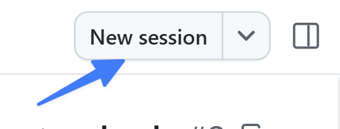

Empezamos añadiendo una pequeña funcionalidad al proyecto, pero los cambios más amplios necesitan un proceso más sólido. La aplicación GitHub Copilot está diseñada para adaptarse al flujo existente de una organización y ayudar a crear lo adecuado de la manera correcta. En esta y varias lecciones siguientes seguirás un proceso habitual de desarrollo con agentes: partirás de una incidencia para crear una funcionalidad, comprobarás que el código es válido y que la funcionalidad se comporta como esperas y, finalmente, integrarás el cambio en el proyecto.

> [!NOTE]
> Usarás la misma sesión durante todo el flujo de trabajo de esta funcionalidad. Normalmente utilizarías sesiones o PR distintas para los diferentes tipos de archivo, pero aquí simplificaremos el proceso para centrarnos en los conceptos principales.

En esta lección:

- iniciarás una sesión nueva de agente desde una incidencia de GitHub;
- definirás los requisitos en modo **Plan**;
- implementarás la funcionalidad con el modo **Autopilot**;
- revisarás el código;
- validarás manualmente la funcionalidad en un canvas de navegador.

Mientras sigues trabajando en esta funcionalidad, actualizarás las instrucciones del repositorio, personalizarás la habilidad existente `quality-checks`, añadirás validación MCP, crearás un agente de QA y abrirás la PR de la funcionalidad.

## Escenario

El catálogo de Tailspin Toys crece y los visitantes necesitan filtrar los juegos por categoría y editorial. La incidencia del backlog describe la funcionalidad, pero antes de programar hay que acordar detalles, como la combinación de categorías. Usarás el modo Plan para resolver esas decisiones y, después, autorizarás una implementación acotada con Autopilot.

## Contexto

Incorporar agentes de programación con IA al flujo de desarrollo no cambia los fundamentos. De hecho, los hace aún más importantes. Muchos desarrolladores siguen un proceso parecido a este:

1. Abrir una incidencia registrada con los detalles del trabajo.
2. Crear un plan de lo que se va a desarrollar.
3. Crear y revisar el código.
4. Ejecutar pruebas para validar el código.
5. Validar manualmente la nueva funcionalidad.
6. Crear una solicitud de incorporación de cambios (PR).
7. Una vez revisado el código y superadas las comprobaciones de integración continua, combinarlo.

> [!NOTE]
> Los detalles exactos dependen del equipo y de la organización, pero la mayoría de los procesos siguen alguna variante de este modelo.

Al seguir este enfoque estándar, te aseguras de que el código generado con IA cumpla los requisitos y pase por el mismo proceso de validación que el código escrito manualmente.

## Modos de sesión

El **modo de sesión** controla el grado de autonomía del agente. Puedes seleccionarlo en el menú desplegable situado debajo del campo del prompt y cambiarlo en cualquier momento:

- **Interactive**: colaboras con el agente. Este sugiere cambios y espera tus indicaciones antes de continuar.
- **Plan**: el agente crea primero un plan. Revisas y apruebas el plan antes de que lo ejecute.
- **Autopilot**: el agente trabaja de forma autónoma: escribe código, ejecuta pruebas e itera sin esperar indicaciones.

Empieza en el modo Plan, revisa el plan y, después, usa Autopilot para implementarlo.

## Inicia una sesión desde la incidencia

Antes de empezar, confirma que se ha combinado la PR de valoraciones con estrellas y que la rama local `main` está actualizada.

1. En **Sessions**, selecciona la carpeta del repositorio Tailspin Toys y, después, **Issues** en la navegación superior del repositorio. Abre la incidencia existente **Allow users to filter games by category and publisher**. No hace falta crear otra incidencia.
2. Selecciona **New session** y elige un **new working tree** basado en `main` actualizada.

   

3. Confirma que la incidencia está adjunta a la sesión y selecciona **Plan** en el selector de modo.

> [!NOTE]
> Si no se encuentra Node.js o npm, pide al agente que ejecute `node --version` y `npm --version`. Si funcionan en tu terminal pero no en la sesión, revisa `PATH` o la configuración del gestor de versiones de la aplicación y, después, ciérrala completamente y vuelve a abrirla. Reintenta la operación y las comprobaciones que fallaron. No reinstales npm solo porque el agente no lo encuentre.

## Planifica la funcionalidad de filtrado

La planificación te permite revisar el enfoque antes de que Copilot escriba código. Como has iniciado la sesión desde la incidencia, Copilot ya tiene la solicitud como contexto. Envía:

```plaintext
Desarrolla esta funcionalidad.
```

Responde a las preguntas de Copilot y compara el plan con los criterios de aceptación de la incidencia. Comprueba que incluye el filtrado por categoría y editorial, controles accesibles, cambios de acceso a datos y pruebas. Aclara cualquier comportamiento poco definido, como la combinación de varias categorías o qué ocurre cuando ningún juego coincide.

El plan debe incluir lint, pruebas unitarias, pruebas E2E y comprobación de tipos con las herramientas existentes del proyecto. Céntralo en implementar y probar el filtrado; crearás la PR después de completar el flujo de calidad. Solicita cambios en el plan antes de aprobarlo y conserva la URL de la incidencia y las aclaraciones acordadas para la validación posterior.

## Aprueba Autopilot explícitamente

Cuando estés conforme con el plan, selecciona **Approve and implement this plan** o la opción equivalente de tu versión. Comprueba el modo activo en lugar de dar por hecho que la aprobación lo cambia. Confirma que el indicador muestra **Autopilot**.

Copilot empezará a trabajar en la implementación. Verás cómo sigue el plan acordado, genera código y ejecuta pruebas.

> [!NOTE]
> Al aprobarlo, la implementación puede empezar de inmediato, así que revisa primero el plan. Si Copilot informa de dependencias ausentes o de un conflicto de puertos, resuelve el problema de configuración antes de dar las comprobaciones por terminadas. Detén solo los servidores que hayas iniciado.

## Revisa y verifica la implementación

Como cualquier otro código, el código generado debe revisarse antes de combinarlo. Revisemos el código y ejecutemos el sitio para comprobar que todo funciona.

1. Abre **Changes** e inspecciona la implementación del filtrado y las pruebas.
2. Compara el resultado con la incidencia y las aclaraciones aprobadas, incluidas las combinaciones de categorías y editoriales. Comprueba que los cambios siguen las instrucciones del repositorio.
3. Examina los resultados de lint, las pruebas unitarias, las pruebas E2E y la comprobación de tipos. Una comprobación omitida no cuenta como superada.
4. Corrige los fallos y vuelve a ejecutar las comprobaciones afectadas antes de aceptar la implementación. La configuración E2E de Playwright compila y sirve una vista previa, y puede reutilizar un servidor local. Asegúrate de que el servidor que pruebas pertenece a este árbol de trabajo, no a una lección anterior.

## Explora la nueva funcionalidad

El código parece correcto, pero ¿se ejecuta? Inicia la aplicación como antes y abre el sitio en un canvas de navegador.

1. Envía este prompt para pedir a Copilot que inicie la aplicación y abra la página en el canvas:

   ```plaintext
   Inicia la aplicación y ábrela en el canvas de navegador.
   ```

2. En unos instantes, la aplicación se iniciará y se abrirá una ventana del navegador dentro de la aplicación Copilot.
3. Selecciona una categoría y confirma que los resultados coinciden. Borra el filtro y, después, selecciona una editorial y confirma que los resultados coinciden.
4. Combina filtros de categoría y editorial y compara los resultados con la incidencia y el plan aprobado. Si se admiten varias categorías, comprueba el comportamiento acordado.
5. Prueba una combinación sin juegos coincidentes y revisa el estado vacío. Borra o restablece los filtros y confirma que vuelve a aparecer la lista completa.
6. Cuando termines, pide a Copilot que detenga el servidor de desarrollo que inició para esta sesión:

   ```plaintext
   Detén el servidor de desarrollo y cierra el canvas de navegador.
   ```

## Conserva esta sesión para las lecciones siguientes

Todavía no crees ni combines la PR de filtrado. Conserva esta sesión, el árbol de trabajo y la rama para las Lecciones 4 a 8. En la siguiente lección aplicarás instrucciones personalizadas al código de filtrado y, después, añadirás mejoras de calidad y QA antes de crear y combinar la PR en la Lección 8. Puedes dejar la sesión inactiva después de detener el servidor y volver a ella en la siguiente lección.

## Resumen y siguientes pasos

Has utilizado distintos modos de agente para crear y revisar una funcionalidad. En esta lección:

- iniciaste una sesión de agente desde una incidencia de GitHub;
- definiste los requisitos en modo **Plan**;
- implementaste la funcionalidad con **Autopilot**;
- revisaste el código;
- validaste manualmente la funcionalidad en un canvas de navegador.

A continuación, descubrirás cómo se genera el código y cómo lograr que siga las prácticas documentadas mediante [instrucciones personalizadas][next-lesson].

## Recursos

- [Trabajar con sesiones de agente en la aplicación GitHub Copilot][agent-sessions]

[next-lesson]: ../4-custom-instructions/
[agent-sessions]: https://docs.github.com/copilot/how-tos/github-copilot-app/agent-sessions
