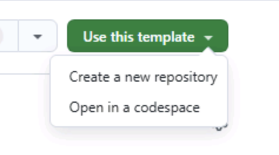

Antes de empezar los ejercicios de VS Code, prepara el entorno. Crearás una copia propia del repositorio Tailspin Toys, pondrás en marcha un [Codespace][codespaces] para trabajar y comprobarás que GitHub Copilot Chat funciona en el editor.

## Configura el repositorio del taller

Para crear una copia del repositorio que utilizarás en los ejercicios, crearás una instancia a partir de la [plantilla][template-repository]. La nueva instancia tendrá todos los archivos necesarios para el taller y la utilizarás durante los ejercicios.

1. En una nueva ventana del navegador, abre la [plantilla Tailspin Toys][tailspin-template].
2. Crea una copia propia del repositorio seleccionando el botón **Use this template** en la página del repositorio del taller. Después, selecciona **Create a new repository**.

   

3. Si participas en un evento organizado por GitHub o Microsoft, sigue las instrucciones de los mentores. En caso contrario, crea el repositorio en una organización donde tengas acceso a GitHub Copilot.

   

4. Anota la ruta del repositorio que has creado (**organization-or-user-name/repository-name**), ya que la necesitarás más adelante.

> [!NOTE]
> **El backlog está preparado**
>
> Cuando crees el repositorio a partir de la plantilla, se generará automáticamente un backlog de incidencias de GitHub. Trabajarás a partir de esas incidencias durante el taller; no tienes que crear ninguna.

## Crea un Codespace

A continuación, usarás un Codespace para completar los ejercicios.

[GitHub Codespaces][codespaces] es un entorno de desarrollo en la nube que permite escribir, ejecutar y depurar código directamente en el navegador. Ofrece un IDE completo con compatibilidad para varios lenguajes de programación, extensiones y herramientas.

1. Abre el repositorio que acabas de crear.
2. Selecciona el botón verde **Code**.

   

3. Selecciona la pestaña **Codespaces** y, después, el botón **+** para crear un Codespace.

   

El Codespace tardará varios minutos en crearse, aunque el proceso es mucho más rápido que instalar todos los servicios manualmente. Mientras tanto, puedes explorar otras funciones de GitHub Copilot que veremos a continuación.

> [!CAUTION]
> Volverás al Codespace en un ejercicio futuro. Por ahora, déjalo abierto en una pestaña del navegador.

> [!NOTE]
> Este taller está preparado para ejecutarse en Codespaces o en un [contenedor de desarrollo][dev-containers] local. Ambos entornos incluyen los requisitos necesarios para que el taller funcione correctamente. Si prefieres trabajar en local, abre el repositorio clonado en VS Code y selecciona **Reopen in Container** cuando aparezca el aviso. VS Code creará el mismo contenedor de desarrollo que usa Codespaces.

[codespaces]: https://github.com/features/codespaces
[dev-containers]: https://code.visualstudio.com/docs/devcontainers/containers

## Usa GitHub Copilot Chat y el modo de agente

Para usar el modo de agente de GitHub Copilot Chat, necesitas tener instalada en el IDE la extensión GitHub Copilot Chat. Si trabajas en GitHub Codespaces, ya debería estar instalada.

> [!TIP]
> Si no tienes instalada la extensión GitHub Copilot Chat, puedes [instalarla desde Visual Studio Code Marketplace][copilot-chat-extension]. También puedes abrir la vista Extensions de Visual Studio Code, buscar **GitHub Copilot Chat** y seleccionar **Install**.

Una vez instalada la extensión, puede que tengas que autenticarte con tu cuenta de GitHub para habilitarla.

1. Vuelve a tu Codespace.
2. Si no ves Copilot Chat a la derecha del editor, selecciona el icono **Copilot Chat** en la parte superior del Codespace.
3. Escribe un mensaje como «Hola, mundo» en la ventana de Copilot Chat y pulsa <kbd>Enter</kbd>. Así se activará Copilot Chat.
4. Si aún no te has autenticado, se te pedirá que inicies sesión en tu cuenta de GitHub. Sigue las instrucciones para autenticarte.

   

5. Después de autenticarte, verás la ventana de Copilot Chat.

## Resumen

¡Has creado una copia del repositorio del taller! También has iniciado la creación de un Codespace, que utilizarás para escribir código.

## Siguiente paso

Empecemos a trabajar con Copilot. Continúa con el [Ejercicio 1: Instrucciones personalizadas][next-lesson], donde enseñarás a Copilot las convenciones del proyecto.

## Recursos

- [Introducción a GitHub Codespaces][codespaces]
- [Crear un repositorio a partir de una plantilla][template-repository]
- [Guía de inicio rápido de Codespaces][codespaces-quickstart]

[tailspin-template]: https://github.com/github-samples/tailspin-toys
[template-repository]: https://docs.github.com/repositories/creating-and-managing-repositories/creating-a-template-repository
[codespaces-quickstart]: https://docs.github.com/codespaces/getting-started/quickstart
[copilot-chat-extension]: https://marketplace.visualstudio.com/items?itemName=GitHub.copilot-chat
[next-lesson]: ../1-custom-instructions/
