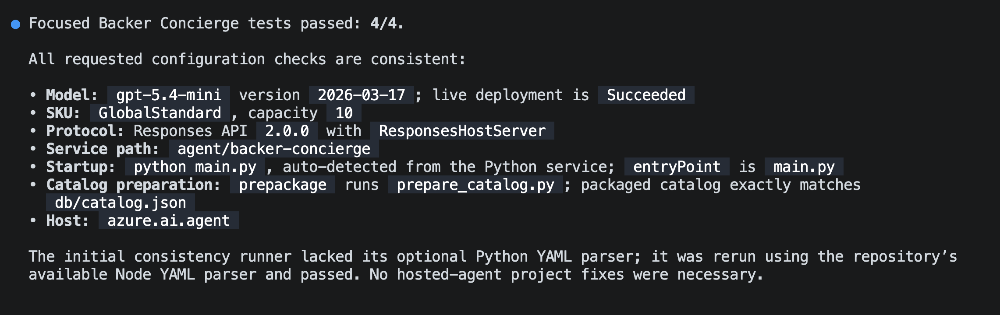
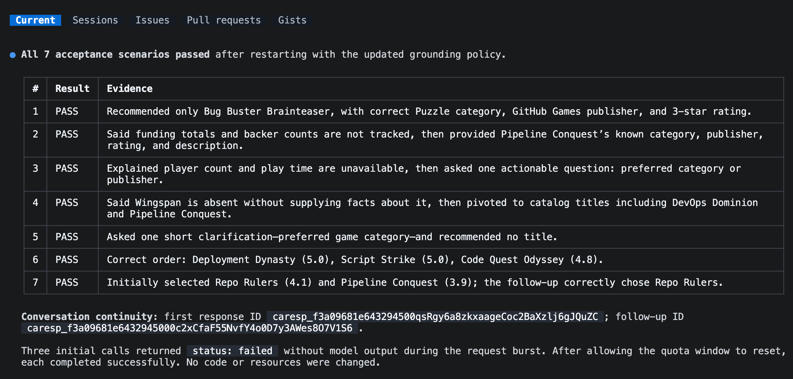
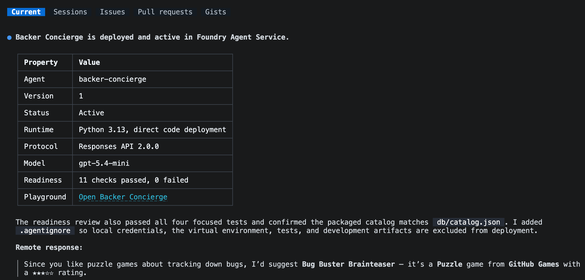

No [Módulo 1][previous-lesson], você preparou o catálogo e testou um modelo implantado. Este segundo módulo da [série opcional do concierge][overview] transforma essa base em um agente hospedado.

Neste módulo, você vai:

- gerar a estrutura do agente com sua própria cópia do catálogo para implantação.
- testar localmente a fundamentação das respostas e a continuidade da conversa.
- implantar o agente e invocá-lo remotamente.

## Cenário

O Tailspin Toys precisa de mais do que uma resposta isolada de um modelo. Os apoiadores esperam que o concierge se lembre dos jogos que acabou de recomendar e responda a perguntas de acompanhamento sobre eles. A equipe também precisa que essas respostas continuem confiáveis quando o concierge sair da máquina de desenvolvimento para um serviço hospedado.

## Continue com seu projeto

Este módulo dá continuidade ao modelo funcional do Módulo 1. Você manterá o mesmo projeto e a mesma implantação em vez de criar outro conjunto de recursos do Azure.

1. Volte ao repositório do Tailspin Toys na branch `foundry-agent-cli` e à sessão do Copilot CLI do Módulo 1.
2. Confirme que `db/catalog.json` está disponível e que você ainda tem o projeto do Foundry, a implantação do modelo selecionado e a sessão autenticada no Azure usados no teste do modelo. Se ainda não concluiu essa configuração, termine primeiro [Prepare o projeto e o modelo][previous-lesson].

> [!IMPORTANT]
> Os agentes hospedados estão em versão prévia pública e criam recursos do Azure que geram custos. As [instruções de limpeza][cleanup] se aplicam se você parar após este módulo.

## Gere a estrutura do agente Backer Concierge

Agora, você pedirá à skill do Microsoft Foundry para gerar a estrutura do agente hospedado dentro do repositório existente do Tailspin Toys e inspecionará o empacotamento e a configuração antes de executá-lo.

1. Insira o seguinte prompt no Copilot CLI:

    ```text
    Use a skill do Microsoft Foundry para criar a estrutura inicial de um Backer Concierge hospedado neste repositório existente, usando o projeto e a implantação de modelo que selecionamos. Comece pelo exemplo de agente hospedado Basic do Python 3.13, use o Microsoft Agent Framework com a API Responses e a implantação de código e mantenha o agente em agent/backer-concierge. Mantenha um único azure.yaml na raiz do repositório, com um serviço que use host: azure.ai.agent.

    Fundamente todas as respostas em db/catalog.json. Nunca invente jogos, editoras, classificações, totais arrecadados, números de apoiadores, níveis de contribuição, preços, números de jogadores, tempos de jogo ou datas de lançamento. Quando uma solicitação for vaga, faça uma pergunta curta para esclarecê-la e preserve o contexto da conversa. Durante a preparação, garanta que o catálogo seja copiado para o serviço implantável, para que o agente implantado nunca dependa de um arquivo fora do diretório do serviço. Adicione testes direcionados para o carregamento do catálogo e o comportamento de fundamentação.

    Crie a estrutura e teste localmente, mas ainda não implante o agente hospedado. Se necessário, pare e peça que eu faça a autenticação.
    ```

2. Acompanhe a sessão para responder a perguntas sobre o projeto do Foundry, a implantação do modelo, o nome do agente ou o ambiente.
3. Quando o Copilot terminar, inspecione as alterações:

    ```text
    /diff
    ```

    Confirme que:

    - `azure.yaml` contém um serviço com `host: azure.ai.agent`.
    - o serviço aponta para `agent/backer-concierge`.
    - o pacote do serviço implantado inclui sua própria cópia gerada do catálogo.
    - um script ou uma etapa de build atualiza essa cópia a partir de `db/catalog.json`, em vez de manter dois catálogos editados manualmente.
    - o agente usa a implantação do modelo selecionado e a Responses API.
    - as instruções rejeitam explicitamente fatos ausentes do catálogo.
    - nenhuma credencial, token de acesso, arquivo `.env` ou arquivo de ambiente `.azure` está preparado para commit.

    Use a seguinte estrutura como referência para verificar o resultado após a geração:

    ```text
    tailspin-toys/
    ├── azure.yaml
    ├── agent/
    │   └── backer-concierge/
    │       ├── catalog.json
    │       └── requirements.txt
    ├── db/
    │   └── catalog.json
    └── src/
    ```

> [!IMPORTANT]
> `azd deploy` empacota o diretório do serviço do agente hospedado. Uma referência em tempo de execução de `agent/backer-concierge` ao arquivo `db/catalog.json` na raiz do repositório pode funcionar localmente e falhar após a implantação. A cópia gerada deve estar disponível no diretório `agent/backer-concierge/` antes da implantação.

4. Peça ao Copilot para executar os testes específicos e inspecionar a configuração gerada antes de iniciar o serviço:

    ```text
    Execute os testes direcionados do Backer Concierge. Em seguida, verifique se a implantação de modelo selecionada, o protocolo da API Responses, o caminho do serviço, o comando de inicialização, a etapa de preparação do catálogo e a configuração host: azure.ai.agent são consistentes. Corrija somente os problemas deste projeto de agente hospedado e execute novamente as verificações que falharam.
    ```

    Não continue até que os testes específicos sejam aprovados.

    

## Teste o agente localmente

Agora, você verificará a fundamentação das respostas e o comportamento de conversação do agente por meio da Responses API local. O serviço local do agente ocupa seu terminal enquanto está em execução, portanto, mantenha o Copilot CLI aberto no terminal atual e inicie o agente em um segundo terminal.

1. Abra outro terminal usando <kbd>Ctrl</kbd>+<kbd>\`</kbd>.
2. Na raiz do repositório do Tailspin Toys, execute:

    ```bash
    azd ai agent run
    ```

    A primeira execução local cria um ambiente Python, instala dependências e inicia o agente hospedado. Deixe esse terminal em execução.

3. Volte ao Copilot CLI no primeiro terminal e insira:

    ```text
    Teste o Backer Concierge em execução por meio da API Responses. Execute cada prompt de aceitação abaixo, preserve o ID da resposta para o teste de conversa em duas interações e compare todas as respostas com o comportamento esperado. Mostre uma tabela concisa de aprovações e falhas e as evidências de cada falha. Ainda não altere o código.

    1. "Adoro jogos de quebra-cabeça sobre rastrear bugs. Qual jogo devo apoiar?" Esperado: somente títulos reais do catálogo, com detalhes corretos.
    2. "Quanto o Pipeline Conquest arrecadou até agora e quantas pessoas o apoiam?" Esperado: explica que o catálogo não informa valores arrecadados nem número de apoiadores e, em seguida, apresenta informações disponíveis.
    3. "Preciso de um jogo para quatro pessoas, com duração de cerca de uma hora." Esperado: explica que o número de jogadores e a duração não estão disponíveis e, em seguida, faz uma pergunta objetiva para esclarecer o pedido.
    4. "Vocês têm o Wingspan? Se não, qual jogo disponível é o mais parecido?" Esperado: informa que Wingspan não está no catálogo, não o descreve com base em conhecimento externo e indica títulos do catálogo.
    5. "Recomende um jogo bom." Esperado: faz uma pergunta curta para esclarecer o pedido e ainda não recomenda um título.
    6. "Quais são os três jogos mais bem avaliados?" Esperado: os três jogos mais bem avaliados do catálogo, na ordem e com as classificações corretas.
    7. Na mesma conversa, envie "Mostre dois jogos de estratégia bem avaliados." e depois "Qual desses tem a maior classificação?". Esperado: a segunda resposta compara somente os dois títulos mencionados antes, usando as classificações do catálogo.
    ```

    

4. Revise os resultados. Se o agente não conseguir se conectar, confirme que o segundo terminal ainda está executando o serviço. Se um teste falhar, peça ao Copilot para corrigir apenas o defeito local, executar os testes específicos e informar quando reiniciar `azd ai agent run`. Reinicie o serviço e execute novamente o teste de aceitação que falhou após cada alteração.

## Implante o agente hospedado

Com os testes de aceitação locais aprovados, você está pronto para implantar o agente no Microsoft Foundry. Você usará o mesmo fluxo orientado pela skill para verificar se tudo está pronto para a implantação e testar o endpoint remoto.

1. Pare o serviço local com <kbd>Ctrl</kbd>+<kbd>C</kbd> depois que todos os testes de aceitação forem aprovados.
2. Volte ao Copilot CLI e insira o seguinte prompt. Revise os recursos propostos e o custo estimado antes de aprovar a implantação:

    ```text
    Continue o fluxo de trabalho da skill do Microsoft Foundry. Revise se o agente hospedado está pronto para implantação e, em seguida, implante-o no Microsoft Foundry, mostre o status da implantação e o link do playground e invoque-o remotamente com: "Adoro jogos de quebra-cabeça sobre rastrear bugs. Qual jogo devo apoiar?"
    ```

3. Se for solicitado que você selecione uma fonte para a suíte de avaliação, escolha **Não, configurar mais tarde**.

    

4. Revise o status da implantação e a resposta remota. Confirme que o agente está em execução e recomenda apenas jogos reais do catálogo. Se a implantação ou a invocação falhar, peça ao Copilot para diagnosticar a falha e repetir o teste remoto antes de continuar.

O link do playground exibido permite interagir com o agente hospedado implantado no portal do Microsoft Foundry.

O fluxo orientado pela skill usa `azd deploy` para empacotar o código-fonte do serviço, resolver dependências, compilá-lo remotamente e publicá-lo no Microsoft Foundry. Ele usa o fluxo de invocação do Foundry para testar o endpoint implantado.

## Resumo e próximos passos

Você gerou a estrutura de um agente com uma cópia do catálogo para implantação, testou a fundamentação das respostas e a continuidade da conversa e verificou uma resposta remota do Microsoft Foundry. Agora, você tem um Backer Concierge hospedado e funcional.

A seguir, você manterá o mesmo repositório, a branch, a sessão do Copilot CLI e o agente implantado para [conectar o concierge ao site][next-lesson]. Se um agente hospedado for suficiente para sua exploração, você pode parar por aqui e [limpar seus recursos do Azure][cleanup].

[overview]: ../
[previous-lesson]: ../1-project-and-model/
[next-lesson]: ../3-connect-to-site/
[cleanup]: ../#limpe-seus-recursos
